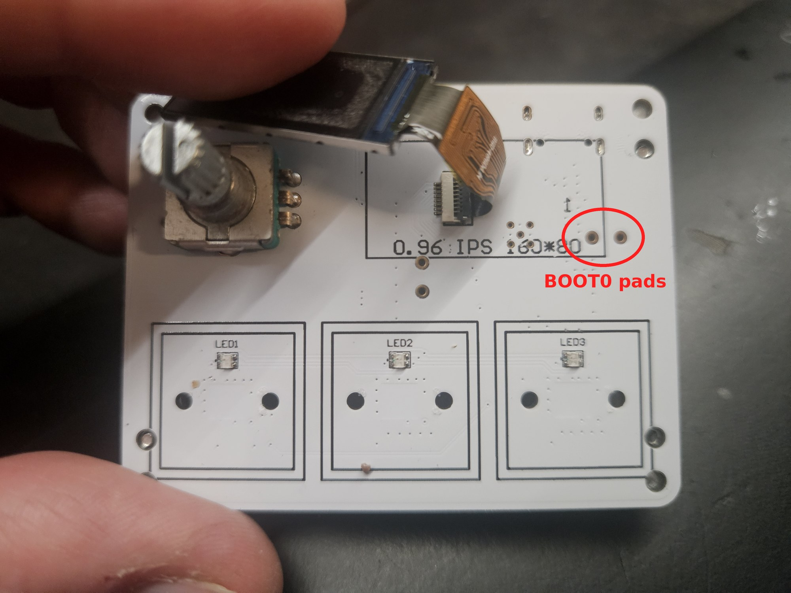

# o3c-firmware

Open firmware for the **SayoDevice O3C** keypad: 3 Hall-effect keys, a rotary knob with a push switch,
3 RGB LEDs and a 0.96" screen, on a WCH CH32V307. Bootloader, app and host tool, all in Rust, with no
vendor code and no HAL.

The keypad becomes a plain USB HID device. A program on the host decides what the keys and the knob do.
The included `o3c run` runs a command per key press, knob click and knob push.

Firmware updates need no hands. The host tool resets the running app into the bootloader, writes the
new app, checks its CRC and starts it, in about 4 seconds. The app can also replace the bootloader. You
open the case once, for the first install.

## Contents

- [Status](#status)
- [Warning](#warning)
- [Features](#features)
- [Hardware](#hardware)
- [Build](#build)
- [First install](#first-install)
- [Updates](#updates)
- [Recovery](#recovery)
- [Use](#use)
- [Internals](#internals)
- [Thanks](#thanks)

## Status

It works, on the board that it was written for: "SayoDevice O3C v1", CH32V307WCU6, USB ID `8089:0009`
before the change. It is in daily use and is not expected to change much. Issues and pull requests
are welcome. There is no plan for new features.

## Warning

⚠️ **The first install erases the stock firmware and SayoDevice's bootloader for good.** The chip's
read protection must come off to write it, and removing it erases the flash. This repository has no copy of the stock firmware. The community
recovery procedure (rentry.org/o3c, "Hardware factory reset") restores the stock firmware with WCH's
own tool. It is not tested here.

Other board revisions can have other pins. Check the [hardware map](#hardware) against your board
before you flash. A wrong pin map does no damage, but the keys, LEDs or screen will not work.

## Features

| Part | Behaviour |
|---|---|
| Keys | Hall sensors, read 4x per millisecond. Press at 400 ADC counts of travel, release below 250 (a full press is about 800). The rest value follows slow drift |
| Knob | Quadrature decoder, one event per click. Push switch |
| LEDs | 8-bit RGB per LED. Off by default. A short blue-white flash when the host configures the keypad. The host can set colours or blink a LED |
| Screen | Diagnostics (firmware version, USB state, knob, key bars) until 5 s after the host configures the keypad. Then black, panel asleep. A firmware fault shows its reason on screen |
| USB | One vendor HID interface (usage page `0xFF00`), 64-byte reports. VID `1209` PID `0001` (pid.codes test PID). Full speed |
| Bootloader | USB HID, 6 KB. LEDs red while it runs. CRC-checked app header: a half-written app never starts |
| Faults | Panics and CPU exceptions turn all LEDs on and print the cause (file and line, or `mcause`/`mepc`) on the screen |

## Hardware

From the stock firmware's code and tests on the device.

| Function | Pins |
|---|---|
| MCU | CH32V307WCU6 (RISC-V, QingKe V4F), 144 MHz from an 8 MHz crystal. Option bytes: 192 KB code + 128 KB RAM |
| Keys left, middle, right | Hall sensors on ADC1 IN13 (PC3), IN12 (PC2), IN11 (PC1). Rest about 2100 counts |
| Knob | PB12 = A, PB13 = B, PB14 = switch (low = pressed). Internal pull-ups |
| LEDs | Matrix. Rows PB2, PB10, PB11 (open-drain, low = on) = red, green, blue. Columns PC6, PC5, PC0 (push-pull, high = on) = left, middle, right LED |
| Screen | ST7735S, 160x80 IPS, on SPI1: PA5 SCK, PA7 MOSI, PA4 reset, PA6 data/command, PB0 chip select. Window offset (1, 26), MADCTL `0xA8`, inverted. The backlight is always on: no pin switches it. PA3 is driven high, as the stock firmware does |
| USB | PB6/PB7, the USBHS controller with its own PHY, run at full speed |
| BOOT0 | Two pads under the screen ([First install](#first-install)) |

## Build

You need Docker. Nothing is installed on the host.

The [releases](https://github.com/PacAnimal/o3c-firmware/releases) have `boot.bin`, `app.bin`, `full.bin`
and `o3c` prebuilt.

    ./build

The results are in `out/`:

| File | Content |
|---|---|
| `boot.bin` | Bootloader, for `0x0000` |
| `app.bin` | App, for `0x8000` |
| `full.bin` | Bootloader, app and app header in one image, for WCH's ROM bootloader |
| `o3c` | Host tool (Linux x86-64; it uses hidraw) |
| `wchisp` | WCH ISP flasher ([ch32-rs/wchisp](https://github.com/ch32-rs/wchisp)), for the first install |

Toolchain: stable Rust, target `riscv32imac-unknown-none-elf`. The firmware's only third-party crate is
`embedded-graphics`.

Give your user access to the keypad, or run `o3c` and `wchisp` as root:

    sudo cp udev/60-o3c.rules /etc/udev/rules.d/
    sudo udevadm control --reload

## First install

This is the only time that you open the case.

1. Pull off the knob and the keycaps. Remove the screws of the top plate and lift it off.
2. Lift the screen out of its place. Keep its flex cable connected. Hang it on the knob shaft.
3. Find the two round pads at the bottom right of the "0.96 IPS 160*80" outline (the red circle).
   The pad inside the outline is BOOT0, with about 5 kΩ to ground. The pad outside is 3.3 V.
4. ⚠️ Do not bridge the two stacked pads below the outline. One is ground.
5. Unplug the keypad. Bridge the two BOOT0 pads with tweezers. Plug the keypad in, then release after
   about 2 seconds. The screen stays dark: WCH's ROM bootloader runs (`4348:55e0`).
6. Remove the read protection. This erases the stock firmware and the chip resets:

       out/wchisp config unprotect

7. Do step 5 again.
8. Write the image:

       ./flash isp

9. Unplug the keypad and plug it in again. The LEDs flash blue-white once, and `out/o3c info` answers.
10. Put the screen and the top plate back.

## Updates

    ./build
    ./flash          # the app, about 4 s
    ./flash boot     # the app, then the app replaces the bootloader and tests it

`flash` finds the keypad in app or bootloader mode. In app mode it resets it into the bootloader first.

`flash boot` erases the bootloader before it writes the new one. A power loss in that second leaves
only the ROM bootloader ([Recovery](#recovery)).

## Recovery

When the app does not answer:

1. Unplug the keypad.
2. Hold the knob down and plug the keypad in. Release the knob. The LEDs show red: the bootloader runs.
3. Run `./flash`.

When the bootloader itself is broken, use WCH's ROM bootloader: steps 1–5 and 8 of
[First install](#first-install). The read protection stays off, so step 6 is not necessary.

## Use

Only one program at a time can talk to the keypad: stop `o3c run` before you use the other commands.

    o3c info                          mode, firmware version, chip UID
    o3c monitor                       raw sensor values and events
    o3c blink <led> <r> <g> <b> [n]   blink a LED n times
    o3c leds <r g b r g b r g b>      set the three LEDs, left to right
    o3c leds                          back to the built-in pattern
    o3c text <line> <text> [0xRGB565] a line on the diagnostics screen
    o3c threshold <key> <press> <release>
    o3c boot | reset                  into the bootloader / restart the app
    o3c flash <app.bin>
    o3c flash-boot <boot.bin>
    o3c pin <A|B|C> <pin> <mode> <level>   debug: set a GPIO (mode = CNF/MODE nibble)
    o3c run <config.toml>             a command per key press, knob click and knob push

`examples/run.toml` shows the configuration. To start `o3c run` with the desktop, use a systemd user
unit or your desktop's autostart.

For your own host program, the protocol is in `proto/src/lib.rs`: 64-byte reports, byte 0 is the
message type, key and knob events arrive as `EVENT` reports.

## Internals

| Path | Content |
|---|---|
| `firmware/hw/` | Startup code, one trap entry (registers saved in software, no interrupt nesting), linker script, clocks, GPIO, SysTick, SPI1, ADC1, flash |
| `firmware/usbhs/` | Polled USB HID device driver for the USBHS controller, after WCH's reference driver |
| `firmware/boot/` | Bootloader |
| `firmware/app/` | App: keys, knob, LEDs (TIM2 interrupt, binary code modulation), screen, USB |
| `proto/` | Wire protocol, shared by the firmware and the host tool |
| `host/` | The `o3c` host tool |

Flash layout:

| Address | Content |
|---|---|
| `0x00000`–`0x07FFF` | Bootloader |
| `0x08000`–`0x2FEFF` | App |
| `0x2FF00` | App header: magic, length, CRC-32. The bootloader writes it after the CRC check |
| RAM `0x20000000` | Handoff word: the app asks the bootloader to stay |

The bootloader decides at reset, before clocks or USB start: a valid header, no handoff word and the
knob not held start the app.

## Thanks

- [khang06](https://github.com/khang06/misc/tree/master/reversing/o3cpatch) for o3cpatch and the
  first look into the stock firmware.
- [sayofw-o3c](https://github.com/ankurCES/sayofw-o3c) for the notes on the vendor protocol.
- WCH's EVT examples for the USBHS register sequence.
- [ch32-rs/wchisp](https://github.com/ch32-rs/wchisp) for the first install.

## License

MIT. See `LICENSE`.
